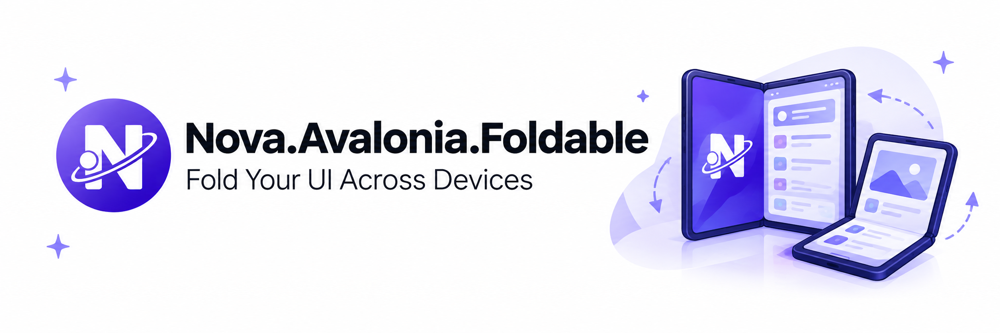
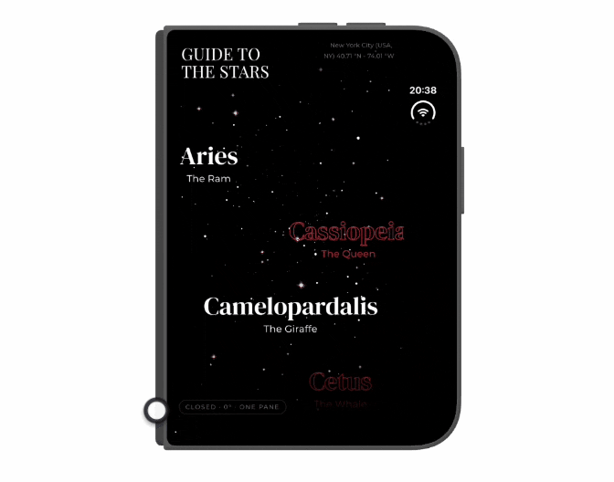
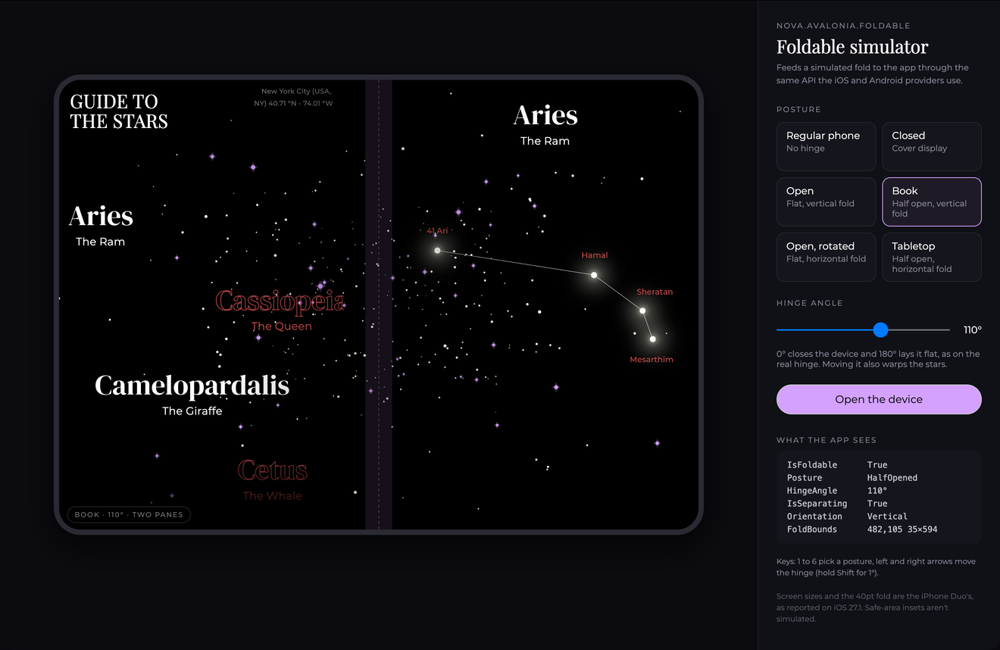

# Nova.Avalonia.Foldable

Foldable device support for [Avalonia](https://avaloniaui.net). It tells your app how the device is folded (posture, hinge angle and where the fold is) on the iPhone Duo and Android foldables, and includes a `TwoPaneView` that places your content on either side of the fold.

<p align="center"></p>

On devices without a fold nothing changes. The library reports no fold and `TwoPaneView` falls back to size-based layout, so the same app runs on phones, tablets, desktop and the web.

<p align="center"></p>

*The Showcase app, "Guide To the Stars" from [Avalonia Vignettes](https://github.com/jsuarezruiz/avalonia_vignettes), on the iPhone Duo simulator.*

## Documentation

The [documentation site](https://jsuarezruiz.github.io/Nova.Avalonia.Foldable/) covers [getting started](docs/docs/getting-started.md), [`TwoPaneView`](docs/docs/twopaneview.md), [reading the fold](docs/docs/fold.md), [testing without a device](docs/docs/testing.md) and [platform details](docs/docs/platforms.md), and has the [API reference](https://jsuarezruiz.github.io/Nova.Avalonia.Foldable/api/Nova.Avalonia.Foldable.html).

## Platform support

| Platform | Fold source | Tested on |
| --- | --- | --- |
| iOS 27.1+ | `UIHingeInteraction` and the view's division region | iPhone Duo simulator |
| Android 6.0+ (API 23) | Jetpack WindowManager and the hinge angle sensor | Pixel Fold emulator |
| Desktop, browser | None, reports no fold | |

The iOS 27.1 APIs aren't in .NET for iOS yet, so this repo carries its own copy of the bindings in [`Nova.Avalonia.Foldable.Bindings.iOS`](src/Nova.Avalonia.Foldable.Bindings.iOS). [Platforms](docs/docs/platforms.md#the-temporary-bindings) explains where they come from and when they go away. On iOS versions before 27.1 the app still runs and reports no fold. Android uses Microsoft's `Xamarin.AndroidX.Window` packages, so it needs no custom bindings.

## Getting started

There's no NuGet package yet, so reference the project from your shared UI project:

```xml
<ProjectReference Include="path/to/src/Nova.Avalonia.Foldable/Nova.Avalonia.Foldable.csproj" />
```

The iOS and Android heads each need one small change before the fold is reported. [Getting started](docs/docs/getting-started.md) walks through both.

## Usage

### Two panes around the fold

```xml
<UserControl xmlns="https://github.com/avaloniaui"
             xmlns:fold="using:Nova.Avalonia.Foldable"
             xmlns:local="using:MyApp.Views">
  <fold:TwoPaneView>
    <fold:TwoPaneView.Pane1>
      <local:InboxView />
    </fold:TwoPaneView.Pane1>
    <fold:TwoPaneView.Pane2>
      <local:MessageView />
    </fold:TwoPaneView.Pane2>
  </fold:TwoPaneView>
</UserControl>
```

`TwoPaneView` follows the WinUI and .NET MAUI `TwoPaneView` API. When the fold divides the screen, as on a half-open device, the panes sit on either side of it, or above and below it in tabletop posture. When it's flat, they split at the fold if there's room (`SnapToFold`, on by default). When it's closed or has no fold, the usual size rules apply (`MinWideModeWidth` and `MinTallModeHeight`, 641 by default), and `PanePriority` picks the pane to show when only one fits. The hidden pane keeps its state.

### Reading the fold

`TwoPaneView` tracks the fold on its own. Anywhere else, set `Fold.IsEnabled` near the root. Every control below it then inherits the fold through the attached properties `Fold.State`, `Posture` (`Unknown`, `Closed`, `HalfOpened` or `Flat`), `HingeAngle`, `IsSeparating`, `Orientation` and `IsFoldable`.

```xml
<UserControl xmlns:fold="using:Nova.Avalonia.Foldable"
             fold:Fold.IsEnabled="True">
  <UserControl.Styles>
    <Style Selector="Border.controls[(fold|Fold.Posture)=HalfOpened]">
      <Setter Property="Opacity" Value="0.85" />
    </Style>
  </UserControl.Styles>

  <TextBlock Text="{Binding $self.(fold:Fold.Posture)}" />
</UserControl>
```

Style selectors separate the namespace with `|`, bindings with `:`. In code, watch for property changes:

```csharp
protected override void OnPropertyChanged(AvaloniaPropertyChangedEventArgs change)
{
    base.OnPropertyChanged(change);

    if (change.Property == Fold.StateProperty && Fold.GetState(this) is { IsTabletop: true } state)
        ShowControlsBelow(state.FoldBounds); // top-level coordinates
}
```

### Without a foldable

A `SimulatedFoldStateProvider` lets you design and test fold layouts on desktop, in the previewer and in headless tests:

```csharp
var fold = new SimulatedFoldStateProvider();
Fold.SetProvider(window, fold);

fold.Current = new FoldState(
    IsFoldable: true,
    Posture: DevicePosture.HalfOpened,
    HingeAngle: 110,
    FoldBounds: new Rect(380, 0, 40, 860),
    IsSeparating: true);
```

The Showcase's desktop app wraps it in a simulator panel:

<p align="center"></p>

## Samples

- [**Sample**](samples/Nova.Avalonia.Foldable.Sample) (iOS, Android) shows every value the library reports and draws the fold over a two-pane layout. Start here when testing a device.
- [**Showcase**](samples/Nova.Avalonia.Foldable.Showcase) (iOS, Android, desktop) is the Guide To the Stars vignette adapted to two screens.

```bash
dotnet run --project samples/Nova.Avalonia.Foldable.Showcase/Nova.Avalonia.Foldable.Showcase.Desktop
```

## Testing on simulators and emulators

[Platforms](docs/docs/platforms.md) explains how to set up the [iPhone Duo simulator](docs/docs/platforms.md#the-iphone-duo-simulator) and the [Pixel Fold emulator](docs/docs/platforms.md#the-pixel-fold-emulator), and how to change postures on each. The [FAQ](docs/FAQ.md) covers emulator quirks and other common problems.

## Limitations

- The iOS bindings are temporary, as [Platforms](docs/docs/platforms.md#the-temporary-bindings) explains.
- The hinge angle is only reported where the platform exposes it. On Android the device needs a hinge sensor and Android 11 or later.
- Avalonia 12 pads the content for safe areas, such as the Duo's sensor edge. `TwoPaneView` accounts for it, but keep it in mind when you position things against `FoldBounds` yourself.

Next on the list are NuGet packages, the official iOS bindings, camera housing regions, and real Auto lengths and animated mode changes in `TwoPaneView`.

## Contributing and license

Contributions are welcome, and reports from real foldables are especially useful. See [CONTRIBUTING.md](CONTRIBUTING.md) and the [FAQ](docs/FAQ.md).

MIT licensed, see [LICENSE](LICENSE). Third-party code and assets are listed in [THIRD-PARTY-NOTICES.md](THIRD-PARTY-NOTICES.md).
