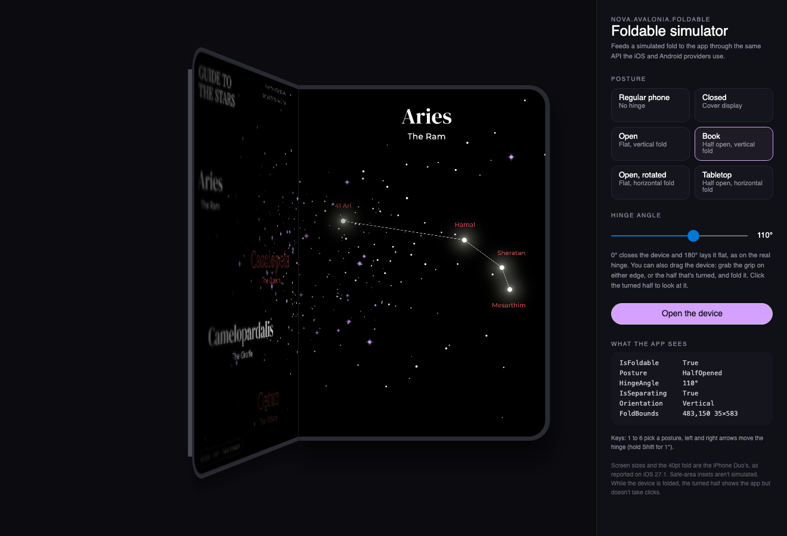

# Testing without a device

You don't need a foldable to build for one. A [SimulatedFoldStateProvider](xref:Nova.Avalonia.Foldable.SimulatedFoldStateProvider) feeds a fold you set from code into the same attached properties the platform providers use, so your layouts can't tell the difference.

## Simulate a fold

Give a window or other top level a simulated provider, then set its state:

```csharp
var fold = new SimulatedFoldStateProvider();
Fold.SetProvider(window, fold);

fold.Current = new FoldState(
    IsFoldable: true,
    Posture: DevicePosture.HalfOpened,
    HingeAngle: 110,
    FoldBounds: new Rect(380, 0, 40, 860), // top-level coordinates
    IsSeparating: true);
```

Setting `Current` raises `Changed`, and the whole tree updates. Set it back to `FoldState.None` to simulate a regular device.

## Replace the provider everywhere

`Fold.ProviderFactory` decides which provider each new top level gets. Return `null` to keep the platform's default:

```csharp
// Every window starts on a simulated book posture while designing.
Fold.ProviderFactory = _ => new SimulatedFoldStateProvider(
    new FoldState(true, DevicePosture.HalfOpened, 110, new Rect(380, 0, 40, 860), true));
```

## Headless tests

With Avalonia's headless platform (`Avalonia.Headless.XUnit`), layout rules can be checked in a unit test. The repository's own tests work this way:

```csharp
[AvaloniaFact]
public void Half_Open_Splits_At_The_Fold()
{
    var view = new TwoPaneView { Pane1 = new Border(), Pane2 = new Border() };
    var window = new Window { Width = 900, Height = 600, Content = view };
    Fold.SetProvider(window, new SimulatedFoldStateProvider(
        new FoldState(true, DevicePosture.HalfOpened, 110, new Rect(430, 0, 40, 600), true)));
    window.Show();
    view.UpdateLayout();

    Assert.Equal(TwoPaneViewMode.Wide, view.Mode);
    Assert.Equal(new Rect(0, 0, 430, 600), view.Pane1!.Bounds);
    Assert.Equal(new Rect(470, 0, 430, 600), view.Pane2!.Bounds);
}
```

## The desktop simulator

`Nova.Avalonia.Foldable.Simulator` runs the app inside a simulated iPhone Duo in a desktop window, with a simulated provider behind it. Add the package to the desktop head:

```bash
dotnet add package Nova.Avalonia.Foldable.Simulator
```

Then show your root view in it:

```csharp
desktop.MainWindow = new FoldableSimulatorWindow(new MainView(), "My app");
```

<p align="center"></p>

It has the regular phone, closed, open, book, open rotated and tabletop postures, with the iPhone Duo's screen sizes and 40pt fold.

- **The device folds in 3D.** One half stays flat and holds the live app. The other turns around the hinge in perspective, showing its half of the app, or the back of the device once it's past 90°, with the cover display that ends up in front when the device closes. Its free edge shows the device's thickness. In book posture the first half turns, as the cover display is on its back; in tabletop the bottom half lies toward you.
- **Light and shade.** The turning half darkens and softens toward its free edge as it turns away, the still half falls into its shadow by the hinge and dims as the screens close, and a crease catches the light along the bend. The cover wakes with a short fade once the device closes. These are the simulator's, not iOS's: on the device, the app is drawn unchanged at any hinge angle.
- **Postures animate.** Picking one moves the hinge there the way the device would: it unfolds before turning sideways, and folds the cover's half shut to close. The app gets every step as a hinge update, so hinge-driven interactions can be tried without a device.
- **The hinge can be dragged.** Grab the grip on either edge of the open device, or the turned half, and fold it. Closed, the grip on the cover's free edge swings it open. Clicking the turned half brings it to the front; only the drawing changes, not the hinge the app sees.
- **The slider and keys** work like the real hinge: 0° closes the device, 180° lays it flat, and anything in between half-opens it. The 1 to 6 keys pick a posture, and the left and right arrows move the hinge (hold Shift for 1°). **Open the device** plays the device unfolding from the cover display to flat.

A readout shows the state the app receives. While the device is folded, the turned half doesn't take clicks, and safe-area insets aren't simulated. [Samples](samples.md#showcase) has the command that runs the Showcase in it. Check the final result on the [iPhone Duo simulator or the Pixel Fold emulator](platforms.md).
