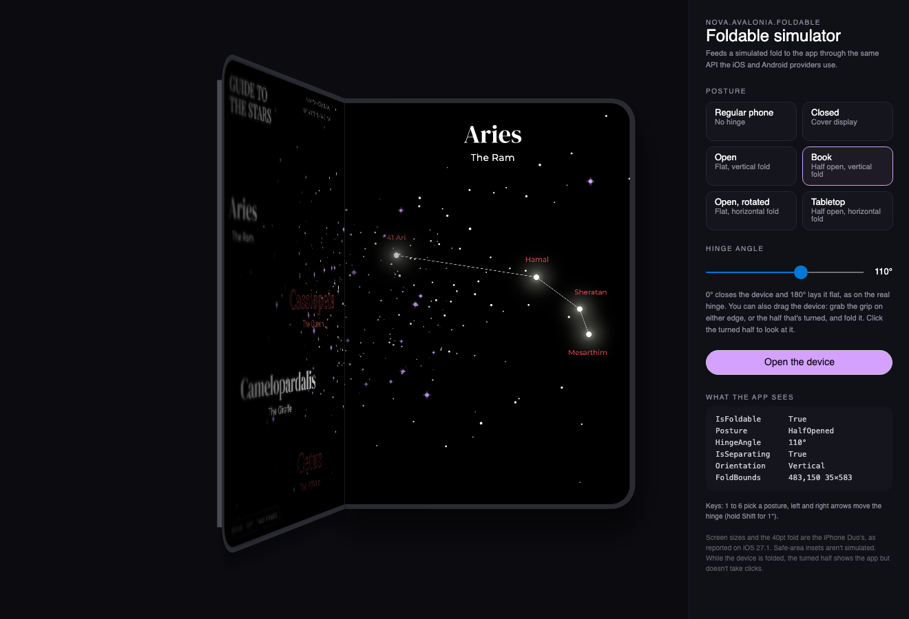

# Nova.Avalonia.Foldable.Simulator

A desktop window that runs your [Nova.Avalonia.Foldable](https://www.nuget.org/packages/Nova.Avalonia.Foldable) app inside a simulated iPhone Duo, so you can design and test fold layouts without a foldable or a mobile simulator.



## Usage

Show your root view in a `FoldableSimulatorWindow` from the desktop head:

```csharp
public override void OnFrameworkInitializationCompleted()
{
    if (ApplicationLifetime is IClassicDesktopStyleApplicationLifetime desktop)
        desktop.MainWindow = new FoldableSimulatorWindow(new MainView(), "My app");

    base.OnFrameworkInitializationCompleted();
}
```

The window gives the app a `SimulatedFoldStateProvider`, so `Fold` and `TwoPaneView` see the simulated device exactly as they see a real one.

## What it does

- **Postures:** a regular phone, closed (the cover display), open, book, open rotated and tabletop, with the iPhone Duo's screen sizes and 40pt fold.
- **The device folds in 3D:** one half stays flat and holds the live app; the other turns around the hinge in perspective, showing its half of the app, or the back of the device, cover display included, once it's past 90°. Its free edge shows the device's thickness, so a half seen edge-on doesn't vanish.
- **Light and shade:** the turning half darkens and softens toward its free edge as it turns away, the still half falls into its shadow by the hinge and dims as the screens close, and a crease catches the light along the bend. This is the simulator's drawing, not iOS: on the device the app is drawn unchanged at any angle.
- **Animated postures:** picking a posture moves the hinge there the way the device would, unfolding before it turns sideways and folding the cover's half shut to close. The app gets every step as a hinge update.
- **A hinge you can drag:** grab the grip on either edge of the open device, or the turned half, and fold it. On the cover display, the grip on the free edge swings it open. Click the turned half to bring it to the front; only the drawing moves, not the hinge.
- **A hinge slider and keys:** 1 to 6 pick a posture, the arrows move the hinge by 5°, or 1° with Shift.
- **A readout** of the `FoldState` the app receives.

While the device is folded, the turned half shows the app but doesn't take clicks. Safe-area insets aren't simulated. Check the final result on the iPhone Duo simulator or an Android foldable emulator.
